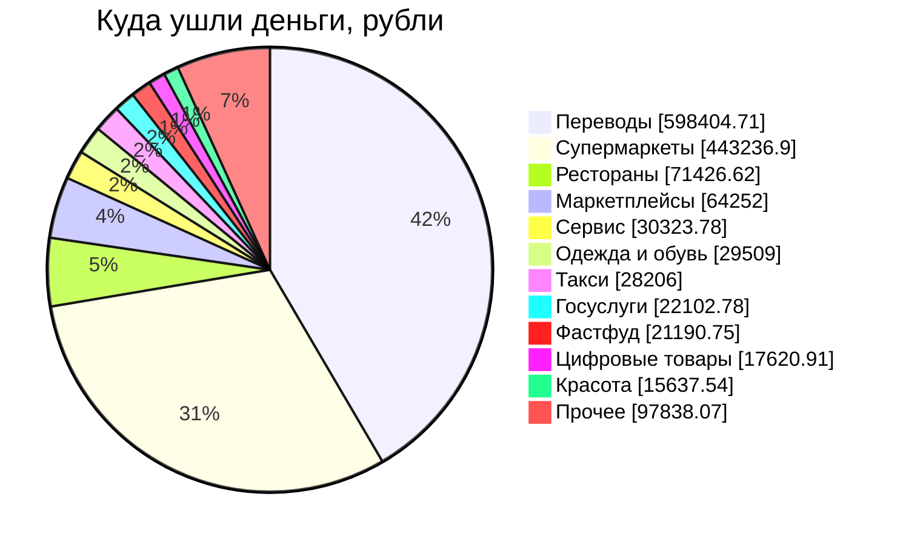

# Куда ушли деньги по статьям

Период: **1 января — 23 ноября 2026**. Счёт Black, все операции в рублях.

В график вошли операции со статусом «Ок», которые банк пометил «Учёт в аналитике — Да»: **1 681 операция на 1 439 749,06 ₽**. Свои категории в выгрузке пустые, поэтому статьи взяты как в банке.

На круге статья видна отдельно, если на неё пришлось от 1% суммы. Остальное собрано в «Прочее», чтобы доли читались. Ниже каждая статья отдельно.

## Все статьи

| Статья | Операций | Сумма, ₽ | Доля |
| --- | ---: | ---: | ---: |
| Переводы | 242 | 598 404,71 | 41,6% |
| Супермаркеты | 635 | 443 236,90 | 30,8% |
| Рестораны | 269 | 71 426,62 | 5,0% |
| Маркетплейсы | 18 | 64 252,00 | 4,5% |
| Сервис | 17 | 30 323,78 | 2,1% |
| Одежда и обувь | 7 | 29 509,00 | 2,0% |
| Такси | 103 | 28 206,00 | 2,0% |
| Госуслуги | 1 | 22 102,78 | 1,5% |
| Фастфуд | 56 | 21 190,75 | 1,5% |
| Цифровые товары | 17 | 17 620,91 | 1,2% |
| Красота | 13 | 15 637,54 | 1,1% |
| Финансы | 9 | 13 410,70 | 0,9% |
| Мобильная связь | 19 | 10 992,00 | 0,8% |
| Связь | 10 | 9 986,01 | 0,7% |
| Ремонт и мебель | 13 | 9 745,59 | 0,7% |
| Аптеки | 14 | 9 034,01 | 0,6% |
| Медицина | 2 | 8 210,50 | 0,6% |
| Местный транспорт | 184 | 8 098,00 | 0,6% |
| Услуги банка | 34 | 6 090,46 | 0,4% |
| Наличные | 2 | 5 500,00 | 0,4% |
| Ж/д билеты | 2 | 5 167,80 | 0,4% |
| Цветы | 1 | 3 200,00 | 0,2% |
| Экосистема Яндекс | 7 | 2 596,00 | 0,2% |
| Различные услуги | 1 | 2 120,00 | 0,1% |
| Турагентства | 1 | 1 265,00 | 0,1% |
| Интернет | 1 | 1 220,00 | 0,1% |
| Искусство | 1 | 840,00 | 0,1% |
| Заправки | 2 | 362,00 | < 0,1% |
| **Итого** | **1 681** | **1 439 749,06** | **100%** |

## Что вошло в «Прочее»

| Статья | Операций | Сумма, ₽ | Доля |
| --- | ---: | ---: | ---: |
| Финансы | 9 | 13 410,70 | 0,9% |
| Мобильная связь | 19 | 10 992,00 | 0,8% |
| Связь | 10 | 9 986,01 | 0,7% |
| Ремонт и мебель | 13 | 9 745,59 | 0,7% |
| Аптеки | 14 | 9 034,01 | 0,6% |
| Медицина | 2 | 8 210,50 | 0,6% |
| Местный транспорт | 184 | 8 098,00 | 0,6% |
| Услуги банка | 34 | 6 090,46 | 0,4% |
| Наличные | 2 | 5 500,00 | 0,4% |
| Ж/д билеты | 2 | 5 167,80 | 0,4% |
| Цветы | 1 | 3 200,00 | 0,2% |
| Экосистема Яндекс | 7 | 2 596,00 | 0,2% |
| Различные услуги | 1 | 2 120,00 | 0,1% |
| Турагентства | 1 | 1 265,00 | 0,1% |
| Интернет | 1 | 1 220,00 | 0,1% |
| Искусство | 1 | 840,00 | 0,1% |
| Заправки | 2 | 362,00 | < 0,1% |
| **Прочее** | **303** | **97 838,07** | **6,8%** |

## Как посчитано

Сумма операции в файле отрицательная: это расход. В графике она взята по модулю.

Не вошли **50 операций на 82 896,25 ₽**. Банк пометил их «Учёт в аналитике — Нет» или статус был не «Ок». Почти вся эта сумма — перевод себе в другой банк.

В статье «Переводы» ещё **77 801,01 ₽** (79 операций) — тоже перевод себе в другой банк, но банк оставил эти операции в аналитике. На графике они внутри «Переводы», отдельной статьёй не выделены.

Имена получателей переводов в репозиторий не выкладывались.
