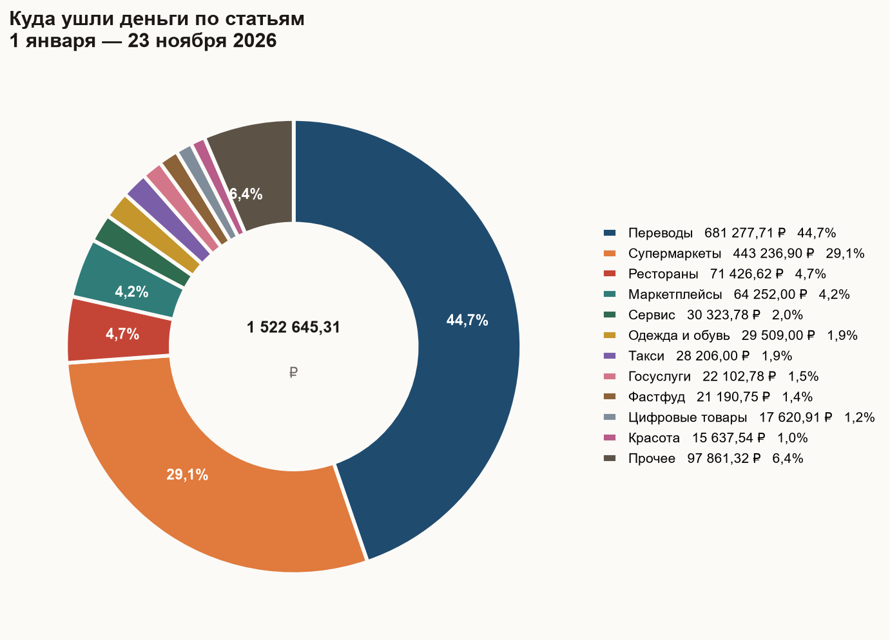

# Куда ушли деньги

Открытая страница, где круговая диаграмма и все имена с названиями из файла:

https://arimberg-svg.github.io/statyi-rashodov-2026/

Период: **1 января — 23 ноября 2026**. Счёт Black. Ушло **1 522 645,31 ₽**, 1 731 операция.

На круге статья отдельно, если на неё пришлось от 1% суммы. В таблицах ниже каждое имя и каждое название так, как в выгрузке.

## Переводы — 681 277,71 ₽, 44,7%

| Название | Операций | Сумма, ₽ |
| --- | ---: | ---: |
| Людмила Х. | 5 | 284 491,95 |
| Себе в другой банк | 123 | 160 574,01 |
| Елена К., сообщение: С днём варенья )) | 78 | 89 850,00 |
| Антон А. | 11 | 35 585,00 |
| Наталья В. | 11 | 20 440,00 |
| Андрей С. | 4 | 15 000,00 |
| Александра М., сообщение: Откажи себе в чем нибудь))), в обработке 100,00 ₽ | 10 | 12 450,00 |
| Александр Н. | 2 | 6 000,00 |
| Людмила В. | 1 | 5 000,00 |
| Надежда М. | 1 | 5 000,00 |
| Софья С. | 2 | 4 700,00 |
| Курбан Г. | 1 | 4 000,00 |
| Марина Ю. | 2 | 3 600,00 |
| Виталий Д. | 2 | 3 400,00 |
| Василий М. | 1 | 3 200,00 |
| Татьяна К. | 2 | 3 200,00 |
| Андрей Р. | 2 | 3 140,00 |
| Алексей Я. | 1 | 3 000,00 |
| Алена М. | 2 | 2 426,00 |
| Илья Е. | 1 | 2 144,00 |
| Варвара Г. | 1 | 1 600,00 |
| Александр Ш. | 1 | 1 500,00 |
| Николай А. | 4 | 1 450,00 |
| Ольга Б. | 1 | 1 389,35 |
| Ксения З. | 1 | 1 250,00 |
| Татьяна И. | 1 | 1 017,00 |
| Татьяна З. | 1 | 1 000,00 |
| Исполнение внешних требований | 2 | 520,40 |
| Аноним | 1 | 500,00 |
| Марина Д. | 1 | 500,00 |
| Ольга Д. | 1 | 500,00 |
| Алексей П. | 1 | 420,00 |
| Максим С. | 1 | 420,00 |
| Тухтамурод Д. | 1 | 407,00 |
| Евгений А. | 1 | 400,00 |
| Анна П. | 1 | 350,00 |
| Тимур А., сообщение: За Дашу Вычерову | 1 | 300,00 |
| Степан К. | 1 | 170,00 |
| Госуслуги | 1 | 165,00 |
| Вадим Ч. | 1 | 109,00 |
| Раиса А. | 1 | 109,00 |

## Супермаркеты — 443 236,90 ₽, 29,1%

| Название | Операций | Сумма, ₽ |
| --- | ---: | ---: |
| Красное и белое | 218 | 196 559,65 |
| Пятёрочка | 127 | 74 825,01 |
| Магнит | 116 | 50 773,04 |
| Перекрёсток доставка | 19 | 30 590,26 |
| Метрополис | 51 | 26 788,40 |
| Монетка | 31 | 13 504,27 |
| Чижик | 8 | 9 129,66 |
| Продуктовый магазин | 13 | 7 950,00 |
| Светлое и Тёмное | 5 | 4 775,74 |
| Яндекс Лавка | 4 | 3 141,00 |
| Магнит Доставка | 2 | 2 983,00 |
| Zajdi Za Myasom | 2 | 2 618,00 |
| Продукты Ермолино | 2 | 2 608,73 |
| Ярче! | 4 | 2 307,79 |
| Лента | 2 | 2 104,21 |
| Купер | 1 | 2 087,59 |
| Жизньмарт | 6 | 2 038,00 |
| Eko Morya | 2 | 1 527,00 |
| Пятёрочка доставка | 1 | 1 315,00 |
| Свинокомплекс Согласие | 1 | 1 175,98 |
| Магазин | 4 | 843,60 |
| IP Karimov V.G. | 1 | 780,00 |
| Мясокомбинат Велес | 2 | 451,04 |
| Перекрёсток | 1 | 309,97 |
| Ассортимент2_P_QR | 1 | 261,98 |
| Pekarnya Syt | 1 | 260,00 |
| Монетка_P_QR | 1 | 254,99 |
| Овощная лавка | 1 | 241,00 |
| СитиМаркет | 1 | 204,00 |
| Sevan Magazin | 1 | 175,00 |
| Ассорти продукты | 1 | 165,00 |
| Тюменский пломбир | 1 | 144,00 |
| Svetloe I Temnoe | 1 | 114,99 |
| Pekarnya Kulinariya | 1 | 90,00 |
| Tyumenskiy plombir | 1 | 73,00 |
| Славица | 1 | 66,00 |

## Рестораны — 71 426,62 ₽, 4,7%

| Название | Операций | Сумма, ₽ |
| --- | ---: | ---: |
| Pennyj Bochonok | 263 | 68 772,32 |
| Biskvitnyj Dvor | 1 | 872,80 |
| Пенный бочонок_P_QR | 3 | 842,00 |
| 45 Kalibr | 1 | 526,50 |
| OOO Impuls | 1 | 413,00 |

## Маркетплейсы — 64 252,00 ₽, 4,2%

| Название | Операций | Сумма, ₽ |
| --- | ---: | ---: |
| WILDBERRIES | 18 | 64 252,00 |

## Сервис — 30 323,78 ₽, 2,0%

| Название | Операций | Сумма, ₽ |
| --- | ---: | ---: |
| Деливери | 14 | 28 024,78 |
| Shu Vey | 1 | 2 000,00 |
| YM*happydns | 1 | 199,00 |
| Нейрохолст | 1 | 100,00 |

## Одежда и обувь — 29 509,00 ₽, 1,9%

| Название | Операций | Сумма, ₽ |
| --- | ---: | ---: |
| Familia | 1 | 14 669,00 |
| ONLYSHE72 | 2 | 9 551,00 |
| Baon | 2 | 3 238,00 |
| Zolla | 1 | 1 606,00 |
| IP Gorbunova M.A. | 1 | 445,00 |

## Такси — 28 206,00 ₽, 1,9%

| Название | Операций | Сумма, ₽ |
| --- | ---: | ---: |
| Яндекс Такси | 103 | 28 206,00 |

## Госуслуги — 22 102,78 ₽, 1,5%

| Название | Операций | Сумма, ₽ |
| --- | ---: | ---: |
| Госуслуги | 1 | 22 102,78 |

## Фастфуд — 21 190,75 ₽, 1,4%

| Название | Операций | Сумма, ₽ |
| --- | ---: | ---: |
| Яндекс Еда | 8 | 8 764,09 |
| IP Kamornikova Yuv5 | 13 | 3 115,47 |
| Электр школа_SBP | 3 | 1 956,00 |
| Вендинговый автомат | 12 | 1 590,00 |
| КШП Центральный | 3 | 1 546,40 |
| Stol-Ya Farmsintez 2 | 7 | 1 349,00 |
| Kofejnya Sobol | 1 | 560,00 |
| Три Богатыря | 2 | 480,00 |
| Бургер Кинг | 1 | 479,99 |
| Магазин | 1 | 389,80 |
| Шаурма | 1 | 350,00 |
| Stol-Ya Farmsintez | 2 | 301,00 |
| Garden | 1 | 209,00 |
| МаксиМ | 1 | 100,00 |

## Цифровые товары — 17 620,91 ₽, 1,2%

| Название | Операций | Сумма, ₽ |
| --- | ---: | ---: |
| FunPay | 6 | 9 943,88 |
| Цифровые товары | 1 | 3 469,00 |
| KJIuHok | 1 | 1 749,00 |
| STARVELL | 3 | 1 124,43 |
| Playerok | 1 | 357,00 |
| Arcadia Labs | 2 | 324,45 |
| Md.*PlayK | 1 | 300,15 |
| VPN | 1 | 249,00 |
| ck*rldofmorgan | 1 | 104,00 |

## Красота — 15 637,54 ₽, 1,0%

| Название | Операций | Сумма, ₽ |
| --- | ---: | ---: |
| Sp_Nude. | 4 | 8 055,00 |
| М.Косметик | 6 | 4 827,54 |
| Evo_Klever | 2 | 2 055,00 |
| Просто стрижка | 1 | 700,00 |

## Финансы — 13 410,70 ₽, 0,9%

| Название | Операций | Сумма, ₽ |
| --- | ---: | ---: |
| Фианит-Ломбард | 6 | 9 239,70 |
| Яндекс Сплит | 1 | 2 171,00 |
| Операция в других кредитных организациях YandexBank_C2A g. Moskva RUS | 2 | 2 000,00 |

## Мобильная связь — 10 992,00 ₽, 0,7%

| Название | Операций | Сумма, ₽ |
| --- | ---: | ---: |
| МТС +7 999 549-50-36 | 9 | 6 175,00 |
| МТС +7 982 917-87-93 | 4 | 2 385,00 |
| МТС | 1 | 1 250,00 |
| Мобайл | 1 | 372,00 |
| МегаФон +7 922 046-61-46 | 1 | 300,00 |
| МегаФон +7 929 263-93-94 | 1 | 300,00 |
| T2 +7 982 912-69-99 | 1 | 200,00 |
| Мобайл +7 961 060-71-31 | 1 | 10,00 |

## Связь — 9 986,01 ₽, 0,7%

| Название | Операций | Сумма, ₽ |
| --- | ---: | ---: |
| Мобайл | 7 | 5 601,00 |
| ЭР-Телеком | 2 | 2 395,01 |
| Яндекс 360 | 1 | 1 990,00 |

## Ремонт и мебель — 9 745,59 ₽, 0,6%

| Название | Операций | Сумма, ₽ |
| --- | ---: | ---: |
| У Михалыча | 13 | 9 745,59 |

## Аптеки — 9 034,01 ₽, 0,6%

| Название | Операций | Сумма, ₽ |
| --- | ---: | ---: |
| AptekaFarmlend43 | 10 | 5 203,61 |
| Живика | 2 | 3 463,40 |
| Аптека Вита | 1 | 199,00 |
| Аптека Ригла | 1 | 168,00 |

## Медицина — 8 210,50 ₽, 0,5%

| Название | Операций | Сумма, ₽ |
| --- | ---: | ---: |
| Альфа Центр Здоровье | 1 | 5 350,50 |
| Стоматология | 1 | 2 860,00 |

## Местный транспорт — 8 098,00 ₽, 0,5%

| Название | Операций | Сумма, ₽ |
| --- | ---: | ---: |
| НСПК | 182 | 6 794,00 |
| EasyWay | 1 | 1 104,00 |
| Тюменская транспортная система | 1 | 200,00 |

## Услуги банка — 6 113,71 ₽, 0,4%

| Название | Операций | Сумма, ₽ |
| --- | ---: | ---: |
| Комиссия за операцию | 15 | 4 308,46 |
| Плата за обслуживание | 9 | 891,00 |
| Плата за оповещения об операциях | 10 | 891,00 |
| Себе в другой банк | 5 | 23,25 |

## Наличные — 5 500,00 ₽, 0,4%

| Название | Операций | Сумма, ₽ |
| --- | ---: | ---: |
| Снятие в банкомате ATM 60079311 | 1 | 3 000,00 |
| Снятие в банкомате Т-Банк | 1 | 2 500,00 |

## Ж/д билеты — 5 167,80 ₽, 0,3%

| Название | Операций | Сумма, ₽ |
| --- | ---: | ---: |
| Федеральная пассажирская компания | 2 | 5 167,80 |

## Цветы — 3 200,00 ₽, 0,2%

| Название | Операций | Сумма, ₽ |
| --- | ---: | ---: |
| Цветочный магазин | 1 | 3 200,00 |

## Экосистема Яндекс — 2 596,00 ₽, 0,2%

| Название | Операций | Сумма, ₽ |
| --- | ---: | ---: |
| Яндекс Плюс | 7 | 2 596,00 |

## Различные услуги — 2 120,00 ₽, 0,1%

| Название | Операций | Сумма, ₽ |
| --- | ---: | ---: |
| Яндекс | 1 | 2 120,00 |

## Турагентства — 1 265,00 ₽, 0,1%

| Название | Операций | Сумма, ₽ |
| --- | ---: | ---: |
| Tutu | 1 | 1 265,00 |

## Интернет — 1 220,00 ₽, 0,1%

| Название | Операций | Сумма, ₽ |
| --- | ---: | ---: |
| Ростелеком Плати Просто | 1 | 1 220,00 |

## Искусство — 840,00 ₽, 0,1%

| Название | Операций | Сумма, ₽ |
| --- | ---: | ---: |
| Spl | 1 | 840,00 |

## Заправки — 362,00 ₽, < 0,1%

| Название | Операций | Сумма, ₽ |
| --- | ---: | ---: |
| AZS Borovoe | 1 | 187,00 |
| Газпромнефть | 1 | 175,00 |

Ещё 50 операций банк пометил «не учитывать в аналитике» или оставил в обработке. На странице они тоже есть: имя и название те же, что в файле.
